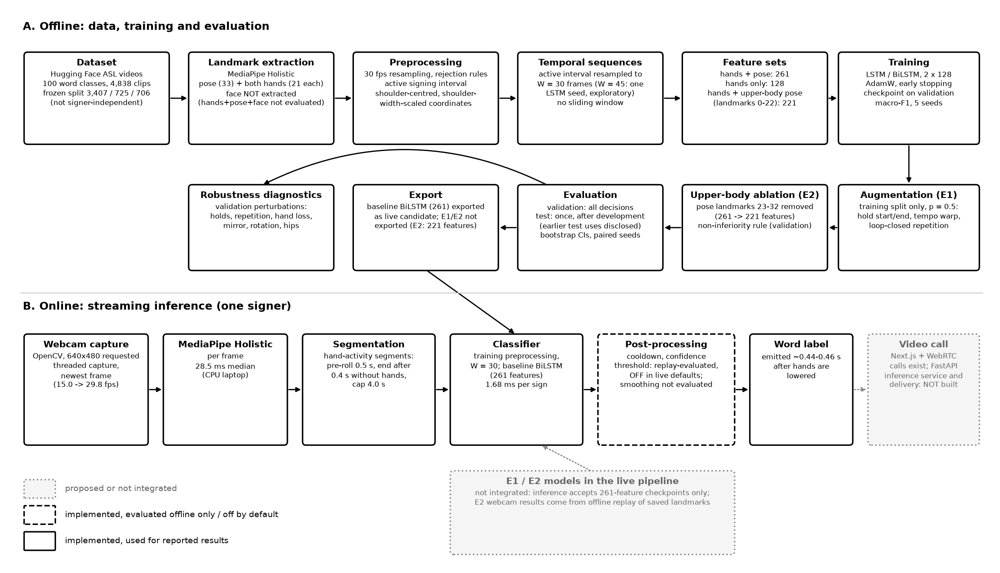
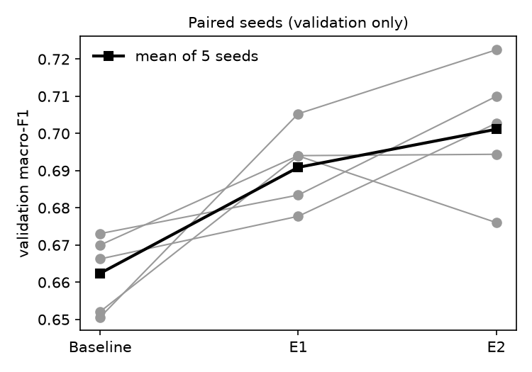
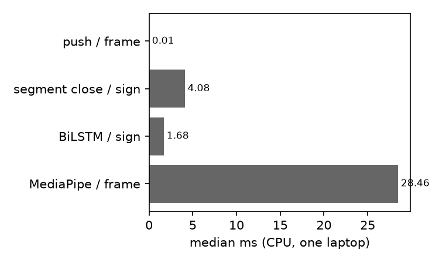
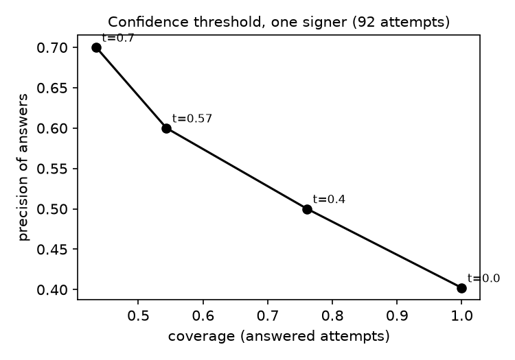
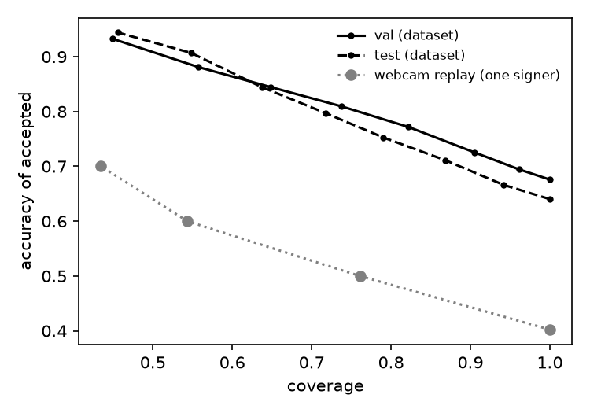

# Landmark-Based Recognition of 100 Isolated American Sign Language Words with Recurrent Networks: Temporal Augmentation, Landmark Ablation and a Single-Signer Streaming Prototype

[AUTHOR INPUT REQUIRED: author names, affiliations, corresponding e-mail]

---

## Abstract

Sign-language recognition inside video-calling software requires a recognizer that is both accurate and
fast enough to run alongside the call. We study landmark-based recognition of 100 isolated American Sign
Language (ASL) words from a public video collection. MediaPipe Holistic hand and body-pose landmarks are
extracted from 4,838 accepted clips (293 of 5,131 candidate clips were rejected by predefined quality
rules), normalized to the signer's shoulders, and the active signing interval of each clip is resampled
to 30 frames. With five training seeds, a bidirectional LSTM (BiLSTM) outperformed a unidirectional LSTM
(test accuracy 63.9 % versus 57.5 %; macro-F1 0.634 versus 0.570). All development decisions were made on
the validation split under rules fixed in advance. Training-only temporal augmentation (E1) improved mean
validation macro-F1 by 0.028 and met the predefined improvement rule; removing lower-body pose landmarks
(E2; 221 instead of 261 features) met a predefined non-inferiority rule but not the improvement rule. In a
one-time final test evaluation, E1 reached 66.1 % accuracy and 0.658 macro-F1, and E2 67.8 % accuracy,
0.675 macro-F1, 0.703 macro-precision and 0.678 macro-recall (means over five seeds). On one laptop CPU,
landmark extraction took a median of 28.5 ms per frame and the BiLSTM 1.68 ms per sign. A streaming
prototype that segments signs by hand activity was evaluated with a single signer: mean top-1 accuracy on
92 webcam attempts was 42.4–43.9 % for the BiLSTM variants, about 21–24 points below the dataset test
accuracy. The dataset split is not signer-independent, the webcam study involves one signer, and the
recognizer is not yet integrated into the WebRTC video call; the results therefore do not establish
performance for unseen signers or in live calls.

**Keywords:** American Sign Language; isolated sign recognition; MediaPipe; LSTM; BiLSTM; data
augmentation; real-time inference; WebRTC

---

## 1 Introduction

Deaf and hard-of-hearing people who use a sign language face communication barriers in video calls
with people who do not sign. Automatic sign-language recognition could provide captions for such calls,
but a practical recognizer must work from an ordinary webcam, run in real time on consumer hardware, and
be evaluated honestly with respect to the signers and recording conditions it will meet.

This work is part of a project that combines a one-to-one video-calling web application (Next.js and
browser WebRTC) with a Python sign-recognition pipeline. The calling application works for one-to-one
calls; the recognizer has been developed and evaluated separately and is **not yet integrated into the
call**. This paper reports the recognition component and a single-signer streaming prototype.

We restrict the task to **isolated-word recognition**: each input contains one sign, and the system
outputs one of 100 word labels. We do not address continuous sign-language recognition or translation
into sentences. We use pose-estimation landmarks rather than raw video as input, because landmarks are
compact, can be computed on a CPU in real time, and abstract away from background and clothing.

### 1.1 Research objectives

The objectives below are stated in the form in which they were evaluated; where the original project
plan was broader, the narrowing is stated explicitly.

- **O1 — Recurrent architecture.** Compare a unidirectional LSTM with a bidirectional LSTM on landmark
  sequences, with five training seeds.
- **O2 — Landmark representation.** Compare hands-only, hands + full-body pose, and hands + upper-body
  pose features on the validation split. (A hands + pose + face representation was planned but not
  evaluated, because face landmarks were not stored for the 100-class subset.)
- **O3 — Training-time temporal augmentation.** Test whether temporal augmentation of training clips
  improves validation performance under a decision rule fixed in advance.
- **O4 — Temporal sequence length (exploratory).** Compare resampling each sign to 30 versus 45 frames.
  Only a single-seed LSTM comparison exists; a 60-frame model and a sliding-window study were not
  carried out.
- **O5 — Accuracy, latency and streaming behaviour.** Measure processing latency on a laptop CPU, adapt
  the isolated-word recognizer to a stream in which signs are separated by pauses, and evaluate
  duplicate suppression and confidence thresholds with one signer.

Reported metrics are accuracy, macro-averaged precision, recall and F1, per-class F1, processing latency,
frames per second, duplicate predictions and missed signs.

### 1.2 Contributions

1. A documented, reproducible landmark pipeline and a 100-class ASL word subset with explicit quality and
   rejection rules (Section 3).
2. A five-seed comparison of LSTM and BiLSTM classifiers with class-stratified bootstrap intervals and
   full disclosure of how the test split was used during development (Sections 4–5).
3. Two pre-registered development steps — temporal augmentation (E1) and lower-body landmark removal
   (E2) — judged on validation with predefined improvement and non-inferiority rules, followed by a single
   final test evaluation, reported with accuracy, macro-precision, macro-recall and macro-F1.
4. Latency measurements and a single-signer evaluation of a streaming prototype, including
   post-processing for duplicate and low-confidence predictions, with its limits stated.

---

## 2 Related Work

### 2.1 Isolated sign recognition and its evaluation

Sign-language recognition is commonly divided into isolated recognition, in which each input contains
one sign, and continuous recognition or translation of signed sentences [1, 2, 3]. Large
public benchmarks for isolated American Sign Language include WLASL [4] and MS-ASL [5], and the
community-sourced ASL Citizen dataset [6]. Surveys stress that results depend strongly on the
evaluation protocol, in particular on whether test signers also appear in training [1, 3]:
random splits of recordings usually overestimate the accuracy that can be expected for new signers. Our
dataset has no signer identities, so we cannot run a signer-independent evaluation, and we state this
limitation alongside every result.

### 2.2 Pose- and landmark-based recognition

Instead of raw video, many systems classify body, hand and face keypoints estimated by a pose model.
MediaPipe [7] provides real-time CPU pipelines for body pose [8], hands [9] and
their combination in Holistic [10]. Skeleton-based isolated recognition on WLASL100 has been
reported with a two-stream graph convolutional network (63.25 % top-1) [11], with a stacked
spatial–temporal Transformer (mean 81.59 % top-1 over ten runs) [12], and with a parallel
bidirectional reservoir-computing model on MediaPipe hand joints (60.85 % top-1) [13]. Self-supervised
models on RGB video currently report higher accuracy on the larger WLASL2000 benchmark and argue that
landmark-only models are limited by missing and misdetected keypoints [14]; RGB pipelines combining a
CNN with an attention LSTM have also been applied to WLASL100 [15]. These numbers come from different
datasets, splits and protocols and are not comparable with ours; we cite them to locate landmark-based
recurrent models among current approaches, not as baselines.

### 2.3 MediaPipe and LSTM systems on small datasets

Several recent systems feed MediaPipe Holistic landmark sequences of about 30 frames into stacked LSTMs,
using small self-recorded datasets. One such system recognises 45 Indian Sign Language letters and words
and reports 88.23 % test accuracy on a random 95:5 split [16]; another reports 97 % accuracy on a
self-collected Indian Sign Language dataset [17]. Their evaluations use random splits without
signer information, so they show feasibility rather than generalization. Our pipeline follows the same
landmark-plus-recurrent design, but on a larger public vocabulary, with five training seeds, bootstrap
intervals, decision rules fixed before each experiment, and an explicit account of test-set use.

### 2.4 Recurrent networks

Long short-term memory (LSTM) networks [18] model sequences with gated memory cells; bidirectional
recurrent networks [19] process a sequence in both directions, and bidirectional LSTMs have been shown
to improve framewise classification of speech [20]. Because an isolated sign is classified only after it
has ended, a bidirectional model can be used without changing the latency of a segment-based recognizer.

### 2.5 Sign language in video conferencing

Real-time sign-language **detection** — deciding whether a participant is signing, without recognising
what is signed — has been demonstrated for video conferencing using pose landmarks and a small LSTM
running in the browser, so that a signing participant can be highlighted as the active speaker
[21]. Browser video calls are commonly built on WebRTC [22]. Our calling application uses
WebRTC for peer-to-peer media; unlike the detection system above, our goal is word **recognition**, and
the recognizer has not yet been integrated into the call.

### 2.6 Evaluation methodology

We follow standard practice for comparing classifiers on shared test data [23]: paired comparisons
on identical inputs, exact McNemar tests for paired binary outcomes [24], and percentile bootstrap
intervals [25]. Macro-averaged precision, recall and F1 weight every class equally and are
appropriate for a vocabulary in which every class matters [26].

---

## 3 Dataset and Preprocessing

### 3.1 Source data

We use the public Hugging Face dataset `akasheroor/American-Sign-Language-Dataset` [27], pinned to
revision `e7979505c0dff7072ef36d45b3cddfffb50ba871`. After reconciling its metadata file with the
repository contents (one file listed but missing and one duplicate metadata row excluded), it contains
108,616 video files labelled with 2,207 word classes. The dataset provides **no signer identities**.
The dataset card states an MIT licence and asks research users to credit the collection to Zahid Yasin
Mittha (2025) [27]. The card also states that the videos were scraped and collected from multiple
sources, without naming them; the original sources, the signers and their consent therefore cannot be
verified from the card, and the data are used here for research purposes only. The card describes
108,618 videos and 2,208 words; our counts above come from reconciling the metadata file with the files
actually present at the pinned revision.

**Frozen split.** Before any landmark extraction, the full collection was split once into training,
validation and test sets (70 / 15 / 15 %, stratified by class, random seed 42) and frozen with a
checksum. The indivisible unit of the split is a group of byte-identical files (SHA-256) joined with its
augmented copies, so that duplicates and augmentation families cannot cross splits. All later quality
rules are applied as flags on this frozen split; no re-splitting was performed.

**100-class subset.** Many classes of the full vocabulary share byte-identical clips with another label
or consist mostly of augmented copies, which would confound a recognition result with label ambiguity.
We therefore selected a development vocabulary of 100 single-word classes by fixed metadata rules: no
clip shared byte-for-byte with another label, no augmented copies, at least six independent validation
and six independent test units, a training share between 60 % and 80 %, at most 10 % within-class
duplicates, at most 50 % of a class from one timestamp batch, and at least two filename collections. The
remaining classes were ranked by a deterministic rule and the top 100 retained. The selection used
metadata only; no model result influenced it. Each clip keeps its frozen-split assignment.

### 3.2 Landmark extraction

Every frame of every candidate clip is processed once with MediaPipe Holistic [10] (version
0.10.21, CPU, `model_complexity = 1`), using a fresh Holistic instance per clip. Holistic estimates 33
body-pose landmarks (with a visibility score), 21 landmarks per hand and, in the solution version used here, 468 face-mesh landmarks (the current
Holistic Landmarker documentation lists 478 face points including iris points [10]); for the
100-class store only the pose and hand landmarks were saved. Landmark sequences are resampled to a
uniform 30 frames per second by linear interpolation between neighbouring frames.

**Active signing interval.** A frame counts as containing a hand if either hand is detected. The active
interval runs from the first to the last frame of the first and last runs of at least three consecutive
hand frames; rest frames outside it are kept in storage but not used as model input.

**Missing landmarks and normalization.** Interior gaps of up to five frames are linearly interpolated;
longer gaps and gaps at the clip edges are zero-filled and marked absent. Coordinates are converted to
pixel units and expressed relative to the midpoint of the shoulders (pose landmarks 11 and 12), divided
by the two-dimensional shoulder distance. Frames without valid shoulders (visibility < 0.5) reuse the
last valid frame.

**Rejection rules.** A clip is rejected if it cannot be decoded, has fewer than 30 decoded frames, has no
active signing interval, has both hands missing in more than 30 % of the active interval, has both hands
missing for more than 15 consecutive active frames, never has valid shoulders, or contains values that
cannot be repaired. Short active intervals (< 30 frames) are flagged but accepted.

### 3.3 Resulting data

Of 5,131 candidate clips of the 100 classes, 4,838 were accepted and 293 rejected: 150 for both hands
missing in more than 30 % of the active interval, 101 for fewer than 30 decoded frames, 36 for both hands
missing for more than 15 consecutive frames, and 6 for having no active signing interval; no clip failed
to decode. Table 1 summarizes the accepted data. Every class is present in every split, with at least 26
training, 4 validation and 4 test clips per class after rejection.

| classes | accepted clips | train / val / test | train clips per class (median, min–max) | signer-independent split |
|---|---|---|---|---|
| 100 | 4838 | 3407 / 725 / 706 | 33 (26–45) | no (no signer IDs) |

**Table 1.** Dataset and split of the 100-class store. Source: `data/sequences/dev100/index.parquet`.

The only grouping information in the file names is four filename collections (2,917 / 1,146 / 708 / 67
accepted clips), each present in every split; they are too coarse to serve as a proxy for signers.
**The split is therefore not signer-independent**: the same signers may appear in training and test,
and test results estimate performance on recordings similar to those in the dataset.

### 3.4 Sequence construction and features

Each clip's active interval of length L frames is uniformly resampled to W frames,
p_k = start + k (L − 1) / (W − 1) for k = 0 … W − 1, with linear interpolation where a landmark group is
present in both neighbouring frames and the nearest frame otherwise. There is no zero-padding, cropping
or random frame selection; W is a temporal resolution, not a fixed real-time duration. Unless stated
otherwise W = 30.

Per frame, the **hands + pose** representation has 261 features: for each hand, 21 landmarks × (x, y, z)
plus a presence flag (2 × 64 = 128); for the pose, 33 landmarks × (x, y, z), a presence flag and 33
visibility values (133). The **hands-only** representation has the first 128 columns. The
**hands + upper-body pose** representation used in E2 removes the 40 columns of pose landmarks 23–32
(hips, knees, ankles, heels and feet: x, y, z and visibility), leaving 221 features. No further feature
scaling is applied.

---

## 4 Methodology and Experimental Protocol

Figure 1 shows the offline pipeline and the online streaming prototype.

**Figure 1.** System pipeline. A: offline data preparation, landmark extraction, preprocessing, training
and evaluation. B: online streaming inference evaluated with one signer. Solid boxes are implemented and
used for the reported results; dashed boxes are implemented but evaluated offline only or disabled by
default; dotted grey boxes are proposed or not integrated (including the video-call integration).

### 4.1 Recurrent classifiers

Both classifiers use two stacked LSTM layers [18] with 128 hidden units and dropout 0.3, followed by
dropout 0.3 and a linear layer to the 100 classes. The **LSTM** classifies from the final hidden state of
the top layer (128 values). The **BiLSTM** [19, 20] concatenates the top layer's forward state after
the last frame and backward state after the first frame (256 values). With 261 input features the LSTM
has 345,188 and the BiLSTM 821,348 trainable parameters; the hands-only BiLSTM has 685,156 and the E2
BiLSTM 780,388. A BiLSTM needs the complete sign before predicting, which is compatible with the
segment-based streaming prototype (Section 4.5).

### 4.2 Training

Models were trained with AdamW [28] (learning rate 10⁻³, weight decay 10⁻⁴) and cross-entropy loss,
batch size 64, for at most 100 epochs. The learning rate was halved when validation macro-F1 did not
improve for 3 epochs, and training stopped after 7 epochs without improvement; the checkpoint with the
highest validation macro-F1 was kept and reloaded for evaluation. Training ran on CPU with four threads
and deterministic algorithms (Python 3.12.6, PyTorch 2.14.1 [29], NumPy 1.26.4). Each configuration
was trained with five seeds (42, 1, 2, 3, 4), which change weight initialization, dropout masks and data
order only. No hyperparameter search was performed.

**E1 — temporal augmentation.** During training only, each clip is, with probability 0.5, modified by
one operation chosen uniformly: a hold of the first or last frame for 10–50 % of the interval length; a
monotone piecewise-linear time warp with local speed factors between 2/3 and 3/2; or one extra cycle of a
sub-span whose end returns to its start (no positional jump larger than 0.15 shoulder widths or the
largest step already in the clip). The augmentation is applied to the stored arrays before the unchanged
resampling, never changes the label, and is not applied to validation, test or live inputs.

**E2 — upper-body pose.** E2 is E1 with the 40 lower-body pose columns removed (221 features), in all
splits.

### 4.3 Evaluation protocol and use of the test split

An evaluation protocol was written down before the E1 and E2 experiments (and amended once, before E2
was run, to add a non-inferiority rule). Its main points are:

- **Roles of the splits.** Training data are used for fitting only; every development decision
  (architecture, features, augmentation, epochs, thresholds) is made on validation; checkpoints are
  selected on validation macro-F1.
- **Improvement rule.** A change is accepted as an improvement if mean validation macro-F1 over the five
  paired seeds rises by at least 0.02 (about twice the seed standard deviation of the reference), it is
  better in at least four of five seeds, and no class has validation F1 = 0.
- **Non-inferiority rule** (for changes that remove inputs, declared before training). The change is
  accepted if the mean paired validation macro-F1 change is ≥ −0.01, the lower bound of its 95 %
  bootstrap interval is ≥ −0.02, and no class has validation F1 = 0.
- **Test-set use.** Before the protocol was written, test metrics had been computed for 13 development
  runs (including the LSTM–BiLSTM seed comparison and the 45-frame run) and in three auxiliary checks
  (Table 2); none of these results was used to choose a model. After development was closed, E1 and E2
  were evaluated on the test split once; the baseline's saved test predictions were reused. The hands-only
  models were never evaluated on test.

| use | count | source |
|---|---|---|
| test metrics computed for development runs | 13 | reports/step4/results/experiment_results.csv (rows with test values) |
| confidence-threshold check on test (candidate s3) | 1 | reports/step6/calibration_hands_pose_w30_bilstm_e100_s3.json |
| latency/parity script: predictions on 20 test clips (equality check only) | 1 | reports/step6/latency_hands_pose_w30_bilstm_e100_s3.json |
| simulated live replay of dataset test clips | 3 | reports/step6/webcam_eval/*_video_replay_dataset-test-clip |
| one-time final test evaluation of E1 and E2 (5 seeds each), after development closed | 1 | reports/paper/final_test/ |
| hands-only test inference | 0 | metadata.json test_evaluated = false |

**Table 2.** Disclosure of test-set use. No test result was used to choose a model.

### 4.4 Metrics and statistical analysis

The primary offline metric is macro-F1, computed over the 100 classes. We also report accuracy and
macro- and support-weighted precision and recall (scikit-learn [30], `zero_division = 0`; macro
averages are unweighted means over classes). For single-label classification, micro-averaged precision,
recall and F1 equal accuracy and are not reported separately. All metrics are computed per training run
(one model and seed on all clips of a split) and then summarised over the five seeds as mean ± sample
standard deviation; predictions of different seeds or models are never pooled.

Uncertainty from the finite set of clips is expressed by 95 % percentile bootstrap intervals [25]
with 2,000 resamples (seed 0) drawn within each true class, so that per-class supports stay fixed; for a
seed mean, the same resample is applied to all seeds, and paired differences between two models use the
same resamples for both. On the webcam attempts, models are compared per seed with exact McNemar tests
[24]. With five seeds, a two-sided sign test cannot reach a p-value below 0.0625; we therefore make
no claim of seed-level statistical significance.

### 4.5 Streaming prototype

The streaming recognizer applies the same per-frame landmark conversion and the same per-segment
preprocessing as training (active-interval detection, normalization, resampling to 30 frames, feature
assembly); for 20 dataset clips, the streaming path produced features identical to the stored training
features and the same predictions. A segment starts after three consecutive frames with a detected hand
and keeps 0.5 s of preceding frames; it ends after 0.4 s without hands or is cut at 4 s, and is then
classified once. Optional post-processing, off by default, comprises a confidence threshold (predictions
below it are withheld), a cooldown (a segment starting within the cooldown after the previous one is
classified but not emitted), and majority-vote smoothing. The live pipeline accepts only 261-feature
models, so the live sessions used a baseline BiLSTM (seed 3, selected as the seed with the highest
validation macro-F1); E1 and E2 were evaluated on the webcam data by offline replay only.

### 4.6 Single-signer webcam evaluation

One signer who is not, to our knowledge, in the dataset (pseudonym S01; the dataset has no signer
identities, so this cannot be verified) recorded sessions with the laptop's camera. The prompted signs
were every tenth class of the vocabulary (AFRICA, BLIND, COMPUTER, DIRECTOR, FORBID, HERE, MORE,
PLEASE, SHOWER, TUESDAY), a rule fixed independently of model results. Each attempt shows a WAIT prompt
and then, once no hand has been visible for 0.5 s, a 5 s GO window. Under strict scoring, an attempt's
answer is the first emitted segment whose hand movement started inside its GO window; later emissions in
the same attempt are duplicates, and an attempt with no segment is missed. Only landmarks, predictions and
timings were saved; no video or images were stored.

The protocol was refined during development (threaded frame capture, a gated GO prompt, framing checks
and corrected scoring), so the webcam data are development data. For model comparison, the segments of
92 core attempts from six sessions recorded with threaded capture at ≥ 25 frames per second were frozen
as frame ranges and replayed through every model, so all models see identical inputs. These results
describe one signer, one camera and one room and are not an estimate of real-world accuracy.

### 4.7 Latency measurement

Latency was measured on one Apple-silicon (arm64) laptop with 8 logical CPU cores and 8 GB of RAM
(macOS 27.0.1), using the CPU only with four PyTorch threads and nothing else running. The classifier
forward pass was timed after 20 warm-up runs over 500 runs at batch size 1; MediaPipe Holistic was timed
per frame on 1,595 frames of 20 test clips (first 10 frames excluded as warm-up). Live capture rates were
taken from the webcam session logs.

---

## 5 Results

All numbers are taken from the saved reports listed under each table; every number in this section is
checked against its source by `scripts/paper_03_verify_claims.py`. Validation results, test results and
single-signer webcam results are reported separately.

### 5.1 Data and evaluation protocol
The dataset contains 100 ASL word classes and 4,838 accepted video clips, split into 3,407 training,
725 validation and 706 test clips, with a median of 33 training clips per class (range 26–45) (Table 1).
The dataset provides no signer identities, so the split is not signer-independent; test results
therefore estimate performance on recordings similar to those in the dataset, not on unseen signers.
All model and design decisions were made on the validation split, with checkpoints selected on validation
macro-F1. Results are reported as the mean ± standard deviation over five training seeds (42, 1, 2, 3, 4),
with 95 % confidence intervals from a class-stratified bootstrap over clips (2,000 resamples). Paired
comparisons use the same seeds and the same bootstrap resamples. The test split was used during
development for 13 training runs and three auxiliary checks (Table 2); none of these results was used
to choose a model. The two final models (E1, E2) were evaluated on test once, after development was
closed.

### 5.2 Recurrent architecture
With hands and full-body pose landmarks (261 features per frame) and 30-frame sequences, the
bidirectional LSTM outperformed the unidirectional LSTM (Table 3). Mean test accuracy was 63.9 ± 1.0 %
(95 % CI 61.1–66.6) for the BiLSTM and 57.5 ± 3.8 % for the LSTM; mean test macro-F1 was 0.634 ± 0.010 and
0.570 ± 0.043. The paired test difference was +6.3 percentage points in accuracy (95 % CI +4.9 to +7.7) and
+0.064 in macro-F1 (+0.049 to +0.078). The BiLSTM was also less sensitive to the training seed
(standard deviation of test accuracy 1.0 versus 3.8 points). These test results were computed during
development and are reported as such.

| split | model | accuracy % (mean ± SD) | 95 % CI | macro-F1 (mean ± SD) | 95 % CI  |
|---|---|---|---|---|---|
| val | LSTM | 60.0 ± 3.2 | 57.4–62.6 | 0.594 ± 0.033 | 0.561–0.615 |
| val | BiLSTM | 66.6 ± 0.9 | 63.9–69.4 | 0.662 ± 0.010 | 0.629–0.685 |
| test | LSTM | 57.5 ± 3.8 | 54.8–60.3 | 0.570 ± 0.043 | 0.537–0.592 |
| test | BiLSTM | 63.9 ± 1.0 | 61.1–66.6 | 0.634 ± 0.010 | 0.600–0.656 |
| val | BiLSTM − LSTM (paired) | +6.6 pts | +5.3 to +7.9 | +0.068 | +0.054 to +0.083 |
| test | BiLSTM − LSTM (paired) | +6.3 pts | +4.9 to +7.7 | +0.064 | +0.049 to +0.078 |

**Table 3.** LSTM versus BiLSTM, hands + full-body pose, 30 frames, five seeds. Test values were computed
during development (Table 2). Sources: `reports/e0/bootstrap/seed_mean.csv`,
`reports/e0/bootstrap/bilstm_minus_lstm.csv`.

### 5.3 Landmark representation
Two representation comparisons were run on the validation split, each with five paired seeds and each
within a fixed training setting (Table 4).

*Hands only versus hands and full-body pose (BiLSTM, no augmentation).* Removing all pose landmarks
(128 instead of 261 features) increased mean validation macro-F1 from 0.662 to 0.685, a paired change of
+0.023 (95 % CI +0.007 to +0.040), with all five seeds higher. Per class, 59 classes improved and 41
declined; the largest declines were for signs articulated at a body or face location, such as VOTE,
REGISTER and PLEASE. The hand coordinates remain expressed relative to the shoulders, so the hands-only
features still carry the body reference frame.

*Upper-body versus full-body pose (BiLSTM with temporal augmentation).* Removing the lower-body pose
landmarks 23–32 (hips, knees, ankles and feet; 221 instead of 261 features) changed mean validation
macro-F1 from 0.691 to 0.701, a paired change of +0.010 (95 % CI −0.002 to +0.023). This comparison was
judged by a non-inferiority rule fixed before the experiment (Section 5.5).

A representation that adds face landmarks was not evaluated: face landmarks were not extracted for this
dataset. Hands-only features were not combined with temporal augmentation and were not evaluated on test.

| setting | representation | features | val macro-F1 (mean ± SD) | paired change (95 % CI) | train − val acc (pts) |
|---|---|---|---|---|---|
| BiLSTM, no augmentation | hands + full pose | 261 | 0.662 ± 0.010 | reference | 32.5 |
| BiLSTM, no augmentation | hands only | 128 | 0.685 ± 0.015 | +0.023 (+0.007 to +0.040) | 30.4 |
| BiLSTM + temporal augmentation | hands + full pose | 261 | 0.691 ± 0.011 | reference | 30.1 |
| BiLSTM + temporal augmentation | hands + upper-body pose (0–22) | 221 | 0.701 ± 0.017 | +0.010 (-0.002 to +0.023) | 28.6 |
| — | hands + pose + face | – | not evaluated | face landmarks not extracted for dev100 | – |

**Table 4.** Landmark representation, validation split, five paired seeds. Sources:
`reports/paper/hands_only/comparison/`, `reports/e2/comparison/`.

### 5.4 Temporal sequence length
Each sign's active interval is resampled to a fixed number of frames. Only one comparison of this length
exists: a single-seed LSTM run with 45 frames reached a validation macro-F1 of 0.518 against 0.600 with
30 frames (Table 5). Because it rests on a single seed and a single architecture, we report it as
exploratory. No 60-frame model was trained. The streaming system segments signs by hand activity rather
than with a sliding window, so sliding-window sizes were not studied.

| frames per sign | model | seed | val macro-F1 | test macro-F1 (reported in development) | model latency b=1 (ms, training run) |
|---|---|---|---|---|---|
| 30 | LSTM | 42 | 0.600 | 0.612 | 0.93 |
| 45 | LSTM | 42 | 0.518 | 0.500 | 1.29 |

**Table 5.** Temporal resampling length (exploratory: one seed, LSTM; not a sliding-window study). Test
values were computed during development. Source: `reports/step4/results/experiment_results.csv`.

### 5.5 Training improvements: temporal augmentation (E1) and upper-body representation (E2)
Starting from the BiLSTM baseline, two changes were evaluated in sequence, each against a paired
reference and a decision rule fixed in advance (Table 6, Figure 2).

*E1, temporal augmentation.* During training only, each clip was, with probability 0.5, given a hold at
its start or end, a mild tempo change, or one extra cycle of a sub-span whose end returns to its start.
Mean validation macro-F1 rose from 0.662 to 0.691, a paired gain of +0.028 (95 % CI +0.017 to +0.041), with
all five seeds improved. This met the predefined improvement rule (gain ≥ 0.02, at least four of five
seeds better, no class with F1 = 0). (Display convention: macro-F1 values and differences are rounded to
three decimals throughout. The unrounded mean gain is 0.02848, i.e. 0.0285 to four decimals; earlier
internal summaries that showed +0.029 rounded twice or averaged per-seed values that had already been
rounded. The rule is met at every precision.)

*E2, upper-body pose on top of E1.* As reported in Section 5.3, the paired validation change was +0.010
(95 % CI −0.002 to +0.023); per seed it ranged from −0.018 to +0.027, with four of five seeds higher. E2
met the predefined non-inferiority rule (mean change ≥ −0.01 and lower confidence bound ≥ −0.02) but not
the improvement rule (gain ≥ 0.02).

| model | val macro-F1 (mean ± SD) | val accuracy % | train − val (pts) | paired change (95 % CI) | test acc / macro-F1 |
|---|---|---|---|---|---|
| Baseline BiLSTM | 0.662 ± 0.010 | 66.6 | 32.5 | reference | 63.9 % / 0.634 (reported in development) |
| E1: + temporal augmentation | 0.691 ± 0.011 | 69.5 | 30.1 | +0.028 (+0.017 to +0.041); 5/5 seeds; §3 met | 66.1 % / 0.658 (one-time final evaluation) |
| E2: E1 + upper-body pose | 0.701 ± 0.017 | 70.5 | 28.6 | +0.010 vs E1 (-0.002 to +0.023); 4/5 seeds; §3a non-inferiority met, §3 not met | 67.8 % / 0.675 (one-time final evaluation) |

**Table 6.** Development ladder on the validation split (paired changes), with the test result of the
one-time final evaluation. Sources: `reports/e1/comparison/`, `reports/e2/comparison/`,
`reports/e0/bootstrap/seed_mean.csv`.

**Figure 2.** Validation macro-F1 per seed for the baseline, E1 and E2 (grey lines connect the same seed;
black: mean of five seeds). Validation split only.

*Final test evaluation.* After development was closed, E1 and E2 were evaluated once on the test split;
the baseline's saved test predictions were reused without re-running it (Table 7). Mean test accuracy was
66.1 ± 1.8 % for E1 (95 % CI 63.5–69.0) and 67.8 ± 1.6 % for E2 (65.3–70.6), against 63.9 ± 1.0 % for the
baseline. Mean test macro-F1 was 0.658 ± 0.019 for E1 and 0.675 ± 0.017 for E2, against 0.634 ± 0.010.
Paired by seed, E2 exceeded the baseline by +3.9 percentage points in accuracy (95 % CI +2.5 to +5.3) and
+0.041 in macro-F1 (+0.026 to +0.057); E1 exceeded the baseline by +2.3 points (+1.1 to +3.6), and E2
exceeded E1 by +1.6 points (+0.4 to +2.8). Each step was better in all five seeds. Per class, E2 improved
test F1 over the baseline for 66 classes and reduced it for 34.

| model | test accuracy % (mean ± SD) | 95 % CI | test macro-F1 (mean ± SD) | 95 % CI  |
|---|---|---|---|---|
| Baseline BiLSTM (saved predictions, reported in development) | 63.9 ± 1.0 | 61.1–66.6 | 0.634 ± 0.010 | 0.600–0.656 |
| E1: + temporal augmentation | 66.1 ± 1.8 | 63.5–69.0 | 0.658 ± 0.019 | 0.625–0.681 |
| E2: E1 + upper-body pose (221 features) | 67.8 ± 1.6 | 65.3–70.6 | 0.675 ± 0.017 | 0.643–0.698 |
| paired e1 - baseline | +2.3 pts | +1.1 to +3.6 | +0.024 (5/5 seeds better) | +0.012 to +0.038 |
| paired e2 - e1 | +1.6 pts | +0.4 to +2.8 | +0.016 (5/5 seeds better) | +0.004 to +0.030 |
| paired e2 - baseline | +3.9 pts | +2.5 to +5.3 | +0.041 (5/5 seeds better) | +0.026 to +0.057 |

**Table 7.** One-time final test evaluation (706 clips, five seeds, class-stratified bootstrap). Sources:
`reports/paper/final_test/seed_mean.csv`, `reports/paper/final_test/paired.csv`.

*Precision and recall.* Macro-averaged precision and recall were computed from the saved test predictions
of each run, without new inference (Table 8). Mean test macro-precision was 0.665 ± 0.012 for the
baseline, 0.689 ± 0.021 for E1 and 0.703 ± 0.018 for E2; mean macro-recall was 0.637 ± 0.011, 0.661 ± 0.019
and 0.678 ± 0.017. For the LSTM, whose test predictions were saved during development, macro-precision
was 0.596 ± 0.051 and macro-recall 0.574 ± 0.040. The models were ordered identically by precision,
recall and F1. Macro-precision exceeded macro-recall by 0.022 to 0.028 for every model. Because every
class has a similar number of test clips, macro-recall is close to accuracy. Computed accuracy and
macro-F1 matched the existing final-test reports exactly for all 15 final-evaluation runs, and for the 10 runs that had
saved development test metrics (baseline and LSTM) all seven metrics matched those as well.

| model | test predictions | accuracy % | macro-precision | macro-recall | macro-F1 | weighted-precision | weighted-recall | weighted-F1 |
|---|---|---|---|---|---|---|---|---|
| LSTM | development | 57.5 ± 3.8 | 0.596 ± 0.051 | 0.574 ± 0.040 | 0.570 ± 0.043 | 0.598 ± 0.050 | 0.575 ± 0.038 | 0.572 ± 0.042 |
| Baseline BiLSTM | saved, reused | 63.9 ± 1.0 | 0.665 ± 0.012 | 0.637 ± 0.011 | 0.634 ± 0.010 | 0.666 ± 0.011 | 0.639 ± 0.010 | 0.636 ± 0.010 |
| E1: + temporal augmentation | one-time final | 66.1 ± 1.8 | 0.689 ± 0.021 | 0.661 ± 0.019 | 0.658 ± 0.019 | 0.691 ± 0.020 | 0.661 ± 0.018 | 0.659 ± 0.019 |
| E2: E1 + upper-body pose | one-time final | 67.8 ± 1.6 | 0.703 ± 0.018 | 0.678 ± 0.017 | 0.675 ± 0.017 | 0.704 ± 0.016 | 0.678 ± 0.016 | 0.675 ± 0.016 |

**Table 8.** Test precision, recall and F1 (mean ± SD over five seeds, per-run metrics; macro = unweighted
mean over the 100 classes, weighted = weighted by class support). Baseline, E1 and E2: one-time final
evaluation (baseline predictions reused); LSTM: test predictions saved during development. Source:
`reports/paper/final_test_prf/seed_mean.csv` (`scripts/paper_05_precision_recall.py`).

*Overfitting.* Training accuracy remained close to 100 % for all three models. The gap between training
and validation accuracy narrowed from 32.5 points (baseline) to 30.1 (E1) and 28.6 (E2), mainly because
validation accuracy increased.

*Robustness diagnostics.* On validation clips with synthetic perturbations (Table 9), temporal
augmentation reduced the accuracy loss caused by a static hold at the start of a sign from −17.1 to −6.8
points and by repeating the sign from −10.9 to −8.0 points. These perturbations resemble the augmentation
operations, so this reduction is partly expected by construction. Sensitivity to losing one hand
(−29.2 points for the baseline) and to mirroring (−17.4) was not reduced. E2 removed the sensitivity to
hip-landmark visibility (−3.0 to 0.0 points) because those inputs are no longer present.

| perturbation | baseline | E1 | E2 |
|---|---|---|---|
| hips_hidden | -0.5 | -0.9 | +0.0 |
| hips_visible | -3.0 | -3.5 | +0.0 |
| hold_start | -17.1 | -6.8 | -7.3 |
| hold_end | -16.9 | -7.6 | -7.6 |
| repeat_x2 | -10.9 | -8.0 | -7.0 |
| drop_minor_hand | -29.2 | -30.8 | -31.1 |
| hand_dropout_20 | -8.9 | -7.8 | -6.5 |
| mirror | -17.4 | -18.2 | -18.2 |
| rotate_10 | -6.0 | -5.6 | -5.3 |
| noise_002 | +0.1 | -0.0 | -0.1 |

**Table 9.** Robustness diagnostics on the validation split: accuracy change versus clean inputs
(percentage points, mean of five BiLSTM seeds). Sources: `reports/e0/robustness/by_model.csv`,
`reports/e1/comparison/robustness_e1_vs_ref.csv`, `reports/e2/comparison/robustness_e2.csv`.

### 5.6 Latency and throughput
All timings were measured on one Apple-silicon laptop CPU (8 GB RAM, four PyTorch threads) (Table 10,
Figure 3). MediaPipe Holistic landmark extraction took a median of 28.5 ms per frame (p95 29.7 ms),
which limits a single process to about 35 frames per second. The BiLSTM classifier took a median of
1.68 ms per sign (batch size 1); in the training runs the LSTM took 0.89 ms and the BiLSTM 1.72 ms.
Closing a segment, including the training preprocessing and the classifier, took a median of 4.1 ms, and
per-frame streaming bookkeeping 0.007 ms. In live capture, reading frames in the main loop limited
processing to 15.0 frames per second; reading them in a background thread raised this to 29.8–29.9
frames per second with the camera's 30 frames per second. A recognised word was emitted a median of
0.44–0.46 s after the signer lowered their hands, dominated by the 0.4 s rest needed to close a segment.
These measurements cover the standalone Python pipeline; latency inside a WebRTC call was not measured.

| component | median ms | p95 ms | note |
|---|---|---|---|
| MediaPipe Holistic per frame | 28.5 | 29.7 | max 35.1 frames/s single process |
| BiLSTM forward, batch 1 | 1.68 | 1.80 | dedicated benchmark, 500 runs |
| LSTM forward, batch 1 (5 training runs) | 0.89 | – | measured inside training runs (median of runs) |
| BiLSTM forward, batch 1 (5 training runs) | 1.72 | – | measured inside training runs (median of runs) |
| streaming push per frame | 0.007 | 0.009 |  |
| segment close: preprocessing + model | 4.1 | 4.9 | 20 dataset clips |
| live capture S2 | 66.6 (frame interval) | 70.2 | 15.0 processed fps; threaded=False |
| live capture S3 | 33.5 (frame interval) | 38.1 | 29.8 processed fps; threaded=True |
| live capture S4 | 33.4 (frame interval) | 34.6 | 29.9 processed fps; threaded=True |

**Table 10.** Latency and throughput on one laptop CPU. Sources:
`reports/step6/latency_hands_pose_w30_bilstm_e100_s3.json`, `reports/step4/results/experiment_results.csv`,
`reports/step6/webcam_eval/<session>/summary.json`.

**Figure 3.** Median processing time per component on one laptop CPU.

### 5.7 Online recognition (single signer)
The streaming recognizer was evaluated with one signer who is not in the dataset. These results describe
this signer and recording setup only and are not an estimate of performance on unseen signers.
Offline and live recognition were consistent: on 20 dataset clips, streaming features and predictions
matched the offline pipeline exactly, and replaying each recorded session's saved landmarks reproduced
every recorded event. On a frozen set of 92 webcam attempts (Table 11), mean top-1 accuracy over five
seeds was 29.8 % for the LSTM, 42.4 % for the BiLSTM baseline, 43.9 % for E1 and 43.7 % for E2; mean top-5
accuracy was 57.2 %, 63.0 %, 66.5 % and 69.6 %. Paired comparisons on these attempts showed no
statistically significant difference between E1 or E2 and the baseline in any seed. For this signer, AFRICA and
COMPUTER were never recognised by any of the 20 models (four model types, five seeds each), and FORBID
was recognised once (by one E2 seed) in 240 model-attempts. In two live sessions with the
baseline model (Table 12), 13 and 9 of 20 attempts were correct, no sign was missed, and 9 and 2 attempts
produced a duplicate prediction.

| model (5 seeds) | top-1 % mean (min–max) | top-5 % mean |
|---|---|---|
| LSTM | 29.8 (23.9–39.1) | 57.2 |
| BiLSTM (baseline) | 42.4 (39.1–46.7) | 63.0 |
| E1 | 43.9 (37.0–47.8) | 66.5 |
| E2 | 43.7 (35.9–51.1) | 69.6 |

**Table 11.** Webcam development replay set: one signer, 92 core attempts, frozen segments (not
generalization evidence). Sources: `reports/e0/webcam_replay_set/summary_by_model.csv`,
`reports/e1/comparison/webcam_replay_paired.csv`, `reports/e2/comparison/webcam_replay_paired.csv`.

| session | protocol | attempts | correct | missed | attempts with duplicates | answers forced-cut (live) | median delay rest-closed s (live) | processed fps | dropped frames |
|---|---|---|---|---|---|---|---|---|---|
| S3 | session 3: threaded capture, gated GO | 20 | 13 | 0 | 9 | 11 | 0.46 | 29.8 | 28/5300 |
| S4 | session 4: controlled protocol - hands o | 20 | 9 | 0 | 2 | 5 | 0.44 | 29.9 | 36/5052 |

**Table 12.** Live streaming sessions with one signer and the baseline BiLSTM (seed 3); session S3
re-scored by replay with the final scoring rules. Sources: `reports/step6/webcam_eval/`.

### 5.8 Post-processing
Duplicate predictions arose mainly when a sign lasting longer than the 4 s segment cap was split and
its continuation classified again: of the 14 duplicate emissions in the replay below, 13 were such
continuations and one was a second burst of movement starting 0.57 s after the hands were last seen in the first segment. Post-processing settings were evaluated by replaying the 92 single-signer
webcam attempts with the baseline model (Table 13, Figure 4). Without post-processing, 37 attempts were
correct and 14 attempts produced one duplicate emission each. A cooldown of 0.5 s or 1.0 s, which
suppresses a segment starting shortly after the previous one, removed all 14 duplicate emissions while
leaving every attempt's answer unchanged. A confidence threshold traded coverage for precision: at 0.4,
76.1 % of attempts were answered with 50.0 % precision; at 0.57, 54.3 % with 60.0 %; at 0.7, 43.5 % with
70.0 %. The threshold of 0.57 had been chosen on validation data for 80 % precision; on the dataset's
test split it gave 77.7 % precision at 74.9 % coverage, whereas on the webcam attempts it gave 60.0 %
precision (Table 14, Figure 5). No sign was missed under any setting. Temporal smoothing of
predictions was implemented but not evaluated. (In this section, "precision" is the fraction of answered
attempts that were correct, and "coverage" the fraction of attempts answered; they are not the
class-averaged precision of Table 8.)

| cooldown s | confidence threshold | attempts | correct | top-1 % | coverage % | precision of answers % | duplicate emissions | missed (no segment) | spurious outside attempts |
|---|---|---|---|---|---|---|---|---|---|
| 0.0 | 0.0 | 92 | 37 | 40.2 | 100.0 | 40.2 | 14 | 0 | 3 |
| 0.5 | 0.0 | 92 | 37 | 40.2 | 100.0 | 40.2 | 0 | 0 | 2 |
| 1.0 | 0.0 | 92 | 37 | 40.2 | 100.0 | 40.2 | 0 | 0 | 2 |
| 0.0 | 0.4 | 92 | 35 | 38.0 | 76.1 | 50.0 | 8 | 0 | 2 |
| 0.0 | 0.57 | 92 | 30 | 32.6 | 54.3 | 60.0 | 5 | 0 | 1 |
| 0.0 | 0.7 | 92 | 28 | 30.4 | 43.5 | 70.0 | 4 | 0 | 0 |

**Table 13.** Streaming post-processing replay: one signer, 92 core attempts, baseline BiLSTM (seed 3).
Sources: `reports/paper/postprocessing/summary_by_setting.csv`, `reports/paper/postprocessing/summary.json`.

**Figure 4.** Coverage and precision of answers for confidence thresholds 0, 0.4, 0.57 and 0.7 on 92
webcam attempts from one signer (baseline model).

| split | accuracy % | ECE (15 bins) | mean confidence |
|---|---|---|---|
| val | 67.6 | 0.093 | 0.768 |
| test | 64.0 | 0.119 | 0.757 |
| threshold 0.57 (chosen on val, 80 % precision target) on test | 77.7 of accepted | – | coverage 74.9 % |

**Table 14.** Confidence calibration of the baseline BiLSTM (seed 3); the test check was run during
development (Table 2). ECE: expected calibration error. Source:
`reports/step6/calibration_hands_pose_w30_bilstm_e100_s3.json`.

**Figure 5.** Accuracy of accepted predictions against coverage for the validation and test splits
(baseline BiLSTM, seed 3) and for the single-signer webcam attempts.

---

## 6 Discussion

**Validation and test findings for E2.** E2 was accepted under a non-inferiority rule that was written
down before it was trained: on validation its mean gain over E1 was +0.010, below the 0.02 required for an
improvement, and only its non-inferiority was established. On the one-time test evaluation E2 exceeded E1
by +1.6 points of accuracy and +0.016 macro-F1 in all five seeds. We report both and do not reclassify E2
as an improvement on the basis of the test result: the selection rule was fixed before the result was
known, the test split is not signer-independent, and the validation and test estimates are compatible with
a small effect of uncertain size. The appropriate reading is that removing the lower-body landmarks did not
harm accuracy and may help slightly, while removing inputs that carry no linguistic information for signs
produced above the waist.

**Precision and recall.** Macro-precision was consistently higher than macro-recall, and both rose
together with macro-F1 from the LSTM to E2; the additional metrics therefore do not change the ranking of
the models. Because test supports are nearly balanced (about seven clips per class), macro-recall carries
almost the same information as accuracy. The higher precision indicates that errors are spread over many
predicted classes rather than concentrated in a few, but per-class precision rests on very few test clips
and should not be interpreted class by class.

**Representation.** On validation, hands-only features outperformed hands with full-body pose, and the
upper-body pose subset was not worse than full-body pose. Together these suggest that, in this dataset,
full-body pose adds more noise than useful information to a model with about 33 training clips per
class. Signs articulated at a body or face location lost accuracy without pose, which indicates that some
body-relative information is useful; whether hands-only or upper-body pose is preferable with temporal
augmentation was not tested.

**Temporal augmentation.** E1 gave the largest validated gain and reduced sensitivity to holds and
repetitions, which occur in live signing but are rare in the dataset clips. Its effect on the
single-signer webcam set was small and not significant, so the offline gain cannot be assumed to transfer
to live use.

**Gap between dataset and live performance.** Accuracy on the single-signer webcam attempts (42.4–43.9 % mean
top-1) was 21–24 points below the corresponding test accuracy on the dataset (63.9–67.8 %). Signs that were never recognised for this signer
point to differences between how this signer and the dataset's signers produce those signs. One signer
cannot show how large this gap is in general.

**Real-time feasibility.** Landmark extraction dominated the per-frame cost (28.5 ms), while the classifier
added under 2 ms per sign, so the BiLSTM's accuracy gain over the LSTM costs less than 1 ms per sign. With
threaded capture the pipeline kept up with a 30 frames-per-second camera on a laptop CPU. The main
delay perceived by a user is the 0.4 s rest used to detect the end of a sign. Running the recognizer
alongside a browser video call on the same machine was not measured and would reduce the available
processing budget.

**Post-processing.** For this signer a short cooldown removed duplicate predictions without changing any
answer, because the duplicates were almost all continuations of the same sign. Confidence thresholds calibrated on
dataset clips were over-optimistic on webcam input, so thresholds need calibration on data from the target
setting.

**Relation to prior work.** Because the split, vocabulary and data source differ from published
benchmarks, our absolute accuracies are not comparable with results reported on other datasets, and we
make no such comparison.

---

## 7 Limitations

1. **Not signer-independent.** The dataset has no signer identities; the split cannot exclude the same
   signers or recording sessions from training and test. Test accuracy does not measure generalization to
   unseen signers.
2. **Test-set reuse.** The test split was evaluated for 13 development runs and three auxiliary checks
   before the final evaluation (Table 2). No model choice used test results, but the baseline's test
   figures were known during development.
3. **One webcam signer.** All live and replay results come from one signer, one camera and one room; the
   webcam set was also inspected during development. These results are descriptive and not representative
   of real-world accuracy.
4. **Seed-level statistics.** With five seeds, a two-sided sign test cannot fall below p = 0.0625; the
   confidence intervals reflect variation across clips, not across independent datasets or signers.
5. **Representation study is incomplete.** Face landmarks were not extracted, so no hands + pose + face
   model was trained; hands-only features were evaluated only on validation and without augmentation; the
   representations were compared within two fixed settings rather than in a full factorial design; no
   representation was tested on unseen signers.
6. **Sequence length.** Only one single-seed comparison (30 versus 45 frames, LSTM) exists; no 60-frame
   model was trained and no sliding-window study was performed.
7. **Isolated words only.** The online system recognises single words separated by pauses; it does not
   recognise continuous signing or sentences, and it does not translate.
8. **Not integrated into the video call.** The Next.js/WebRTC application supports one-to-one video
   calls, but the recognizer runs as a separate Python program; delivery of recognised words into the call
   was designed but not implemented. The live pipeline accepts only 261-feature models, so E1 and E2 were
   evaluated offline; the live sessions used the baseline model.
9. **One hardware platform.** Latency was measured on one laptop CPU; other devices, browsers and
   concurrent load from a video call were not measured.
10. **Overfitting remains.** Training accuracy is close to 100 % and the training–validation gap is about
    29 points for the final model.
11. **Precision and recall per class** rest on about seven test clips per class and are reported only as
    macro and weighted averages.

---

## 8 Conclusion and Future Work

We built and evaluated a landmark-based recognizer for 100 isolated ASL words and a streaming pipeline
that runs in real time on a laptop CPU. A bidirectional LSTM outperformed a unidirectional LSTM by 6.3
points of test accuracy. Temporal augmentation improved validation macro-F1 by 0.028, and removing
lower-body pose landmarks was non-inferior on validation; on a single final test evaluation, the resulting
model reached 67.8 % accuracy and 0.675 macro-F1, 3.9 points above the baseline, with macro-precision
0.703 and macro-recall 0.678. Hands-only features outperformed hands with full-body pose on validation.
Landmark extraction, not classification, dominates the processing cost, and a short cooldown removed
duplicate predictions in single-signer replays. Because the dataset split is not signer-independent and
live evaluation involved one signer, these results do not establish performance for unseen signers.

Future work, none of which is part of the results above:
- evaluation on a signer-independent split (for example a signer-labelled public dataset) and with
  several new signers recruited with informed consent;
- hands-only and upper-body representations combined with temporal augmentation, a hands + pose + face
  representation, and a multi-seed study of sequence length including 60 frames;
- support for reduced feature sets (E2) in the live pipeline;
- integration of the recognizer into the WebRTC call (for example an inference service receiving
  landmarks or frames from the browser and returning word captions), and measurement of end-to-end latency
  during calls;
- calibration of confidence thresholds and post-processing on data from the target setting;
- extension from isolated words towards continuous recognition.

---

## Ethics and Consent Statement

[AUTHOR INPUT REQUIRED: The project files contain no record of an ethics review or of a written consent
procedure. State (a) whether institutional ethics approval or an exemption applies; (b) who signer S01 is
and that they consented to the recording and its use in this paper. Verified facts that can be used: the
webcam study involved a single signer under a pseudonym; no video or images were stored — only landmark
coordinates, predictions and timings.]

## Data and Code Availability

The video data are publicly available from the Hugging Face dataset cited in Section 3.1 at the pinned
revision. Landmark arrays, experiment outputs and evaluation scripts are kept in the project repository.
[AUTHOR INPUT REQUIRED: repository URL or availability statement.]

---

## References

[1] D. Bragg, O. Koller, M. Bellard, L. Berke, P. Boudreault, A. Braffort, N. Caselli, M. Huenerfauth, H. Kacorri, T. Verhoef, C. Vogler and M. Ringel Morris, "Sign language recognition, generation, and translation: An interdisciplinary perspective," in Proc. 21st Int. ACM SIGACCESS Conf. on Computers and Accessibility (ASSETS), 2019, pp. 16–31, doi:10.1145/3308561.3353774.

[2] R. Rastgoo, K. Kiani and S. Escalera, "Sign language recognition: A deep survey," Expert Systems with Applications, vol. 164, art. 113794, 2021, doi:10.1016/j.eswa.2020.113794.

[3] O. Koller, "Quantitative survey of the state of the art in sign language recognition," arXiv:2008.09918, 2020.

[4] D. Li, C. Rodriguez Opazo, X. Yu and H. Li, "Word-level deep sign language recognition from video: A new large-scale dataset and methods comparison," in Proc. IEEE Winter Conf. on Applications of Computer Vision (WACV), 2020; arXiv:1910.11006.

[5] H. R. Vaezi Joze and O. Koller, "MS-ASL: A large-scale data set and benchmark for understanding American Sign Language," in Proc. British Machine Vision Conf. (BMVC), 2019; arXiv:1812.01053.

[6] A. Desai, L. Berger, F. O. Minakov, V. Milan, C. Singh, K. Pumphrey, R. E. Ladner, H. Daumé III, A. X. Lu, N. Caselli and D. Bragg, "ASL Citizen: A community-sourced dataset for advancing isolated sign language recognition," arXiv:2304.05934, 2023.

[7] C. Lugaresi, J. Tang, H. Nash, C. McClanahan, E. Uboweja, M. Hays, F. Zhang, C.-L. Chang, M. G. Yong, J. Lee, W.-T. Chang, W. Hua, M. Georg and M. Grundmann, "MediaPipe: A framework for building perception pipelines," arXiv:1906.08172, 2019.

[8] V. Bazarevsky, I. Grishchenko, K. Raveendran, T. Zhu, F. Zhang and M. Grundmann, "BlazePose: On-device real-time body pose tracking," arXiv:2006.10204, 2020.

[9] F. Zhang, V. Bazarevsky, A. Vakunov, A. Tkachenka, G. Sung, C.-L. Chang and M. Grundmann, "MediaPipe Hands: On-device real-time hand tracking," arXiv:2006.10214, 2020.

[10] Google AI Edge, "Holistic landmarker guide," MediaPipe documentation. https://developers.google.com/edge/mediapipe/solutions/vision/holistic_landmarker (accessed 27 Oct. 2026).

[11] A. S. M. Miah, M. A. M. Hasan, S. Nishimura and J. Shin, "Sign language recognition using graph and general deep neural network based on large scale dataset," IEEE Access, vol. 12, pp. 34553–34569, 2024, doi:10.1109/ACCESS.2024.3372425.

[12] K. Hirooka, A. S. M. Miah, T. Murakami, M. A. M. Hasan, Y. S. Hwang and J. Shin, "Stack Transformer based spatial-temporal attention model for dynamic sign language and fingerspelling recognition," arXiv:2503.16855, 2025.

[13] N. K. Singh, A. R. Syulistyo, H. Tamukoh and Y. Tanaka, "Sign language recognition using parallel bidirectional reservoir computing," arXiv:2512.19451, 2025 (accepted for Nonlinear Theory and Its Applications, IEICE).

[14] R. Wong, N. C. Camgoz and R. Bowden, "SignRep: Enhancing self-supervised sign representations," arXiv:2503.08529, 2025.

[15] D. Kumari and R. S. Anand, "Isolated video-based sign language recognition using a hybrid CNN-LSTM framework based on attention mechanism," Electronics, vol. 13, no. 7, art. 1229, 2024, doi:10.3390/electronics13071229.

[16] S. Srivastava, S. Singh, Pooja and S. Prakash, "Continuous sign language recognition system using deep learning with MediaPipe Holistic," Wireless Personal Communications, Springer, doi:10.1007/s11277-024-11356-0.

[17] N. Anithadevi, S. Palanisamy, S. Saranya Rubini and S. Shrestha, "MediaPipe-LSTM-enhanced framework for real-time dynamic sign language recognition in inclusive communication systems," Engineering Reports, vol. 7, e70142, 2025, doi:10.1002/eng2.70142.

[18] S. Hochreiter and J. Schmidhuber, "Long short-term memory," Neural Computation, vol. 9, no. 8, pp. 1735–1780, 1997, doi:10.1162/neco.1997.9.8.1735.

[19] M. Schuster and K. K. Paliwal, "Bidirectional recurrent neural networks," IEEE Trans. Signal Processing, vol. 45, no. 11, pp. 2673–2681, 1997, doi:10.1109/78.650093.

[20] A. Graves and J. Schmidhuber, "Framewise phoneme classification with bidirectional LSTM and other neural network architectures," Neural Networks, vol. 18, no. 5–6, pp. 602–610, 2005, doi:10.1016/j.neunet.2005.06.042.

[21] A. Moryossef, "Developing real-time, automatic sign language detection for video conferencing," Google Research Blog, 1 Oct. 2020. https://research.google/blog/developing-real-time-automatic-sign-language-detection-for-video-conferencing/

[22] C. Jennings, H. Boström and J.-I. Bruaroey (eds.), "WebRTC 1.0: Real-time communication between browsers," W3C Recommendation, 26 Jan. 2021. https://www.w3.org/TR/2021/REC-webrtc-20210126/

[23] T. G. Dietterich, "Approximate statistical tests for comparing supervised classification learning algorithms," Neural Computation, vol. 10, no. 7, pp. 1895–1923, 1998, doi:10.1162/089976698300017197.

[24] Q. McNemar, "Note on the sampling error of the difference between correlated proportions or percentages," Psychometrika, vol. 12, no. 2, pp. 153–157, 1947, doi:10.1007/BF02295996.

[25] B. Efron, "Bootstrap methods: Another look at the jackknife," Annals of Statistics, vol. 7, no. 1, pp. 1–26, 1979, doi:10.1214/aos/1176344552.

[26] M. Sokolova and G. Lapalme, "A systematic analysis of performance measures for classification tasks," Information Processing & Management, vol. 45, no. 4, pp. 427–437, 2009, doi:10.1016/j.ipm.2009.03.002.

[27] Z. Y. Mittha, "American Sign Language Dataset," Hugging Face dataset, 2025; copy used: akasheroor/American-Sign-Language-Dataset, revision e7979505c0dff7072ef36d45b3cddfffb50ba871, MIT License. https://huggingface.co/datasets/akasheroor/American-Sign-Language-Dataset (accessed 27 Oct. 2026).

[28] I. Loshchilov and F. Hutter, "Decoupled weight decay regularization," in Proc. Int. Conf. on Learning Representations (ICLR), 2019; arXiv:1711.05101.

[29] A. Paszke, S. Gross, F. Massa, A. Lerer, J. Bradbury, G. Chanan, T. Killeen, Z. Lin, N. Gimelshein, L. Antiga, A. Desmaison, A. Köpf, E. Yang, Z. DeVito, M. Raison, A. Tejani, S. Chilamkurthy, B. Steiner, L. Fang, J. Bai and S. Chintala, "PyTorch: An imperative style, high-performance deep learning library," in Advances in Neural Information Processing Systems (NeurIPS), 2019; arXiv:1912.01703.

[30] F. Pedregosa, G. Varoquaux, A. Gramfort, V. Michel, B. Thirion, O. Grisel, M. Blondel, P. Prettenhofer, R. Weiss, V. Dubourg, J. Vanderplas, A. Passos, D. Cournapeau, M. Brucher, M. Perrot and É. Duchesnay, "Scikit-learn: Machine learning in Python," Journal of Machine Learning Research, vol. 12, pp. 2825–2830, 2011.

---

## Appendix A — Reproducibility

All commands run from the `model/` directory of the project repository. Scripts refuse to overwrite
existing experiment directories or the one-time final-test output.

| item | command or file |
|---|---|
| frozen split, dataset revision, seed | `configs/step1_data.yaml`; `data/splits/split_v1*.csv`; `scripts/s1_04_make_split.py` |
| 100-class vocabulary | `configs/vocabulary_100.json`; `scripts/s5_01_select_vocabulary.py` |
| landmark extraction (MediaPipe 0.10.21) | `scripts/s2_02_extract_landmarks.py --vocabulary configs/vocabulary_100.json --profile hands_pose_f32 --out-dir data/landmarks/dev100_hp` |
| sequence index | `scripts/s3_04_prepare_store.py`; `data/sequences/dev100/index.parquet`, `index_summary.json` |
| one training run (example: baseline, seed 1) | `PYTHONPATH=src .venv/bin/python scripts/s4_02_run_experiment.py --store dev100_hp --model bilstm --feature-config hands_pose --window 30 --max-epochs 100 --seed 1 --tag e100_s1` |
| run outputs | `experiments/dev100_hp/<experiment_id>/` (`config.json`, `metadata.json`, `best.pt`, `predictions_*.csv`, `metrics_*.json`) |
| E1 / E2 comparisons (validation) | `scripts/e1_01_compare.py`; `scripts/e2_01_compare.py`; `reports/e1/`, `reports/e2/` |
| one-time final test (already run; refuses to run again) | `scripts/e3_01_final_test.py`; outputs `reports/paper/final_test/` |
| precision / recall from saved predictions | `PYTHONPATH=src .venv/bin/python scripts/paper_05_precision_recall.py` → `reports/paper/final_test_prf/` |
| tables and figures | `PYTHONPATH=src .venv/bin/python scripts/paper_01_tables.py`; `scripts/paper_02_pipeline_figure.py` |
| number check of this manuscript | `PYTHONPATH=src .venv/bin/python scripts/paper_03_verify_claims.py --draft reports/paper/draft/manuscript.md --out reports/paper/draft/manuscript_claims_verification.md --tables reports/paper/tables_figures_v2/TABLES.md` |
| latency | `scripts/s6_02_measure_latency.py`; `reports/step6/latency_hands_pose_w30_bilstm_e100_s3.json` |
| webcam replay and post-processing | `scripts/e0_02_webcam_replay_set.py`; `scripts/pp_01_postprocessing_replay.py` |

Software: Python 3.12.6, PyTorch 2.14.1, NumPy 1.26.4, MediaPipe 0.10.21, scikit-learn
(`precision_recall_fscore_support`). Hardware: one Apple-silicon (arm64) laptop, 8 logical CPU cores,
8 GB RAM, CPU only, four PyTorch threads.

### Table ID mapping
Manuscript tables correspond to the generated tables in `reports/paper/tables_figures_v2/TABLES.md` as
follows: Table 1 = T1, 2 = T12, 3 = T2, 4 = T3, 5 = T4, 6 = T5, 7 = T5b, 8 = new (from
`reports/paper/final_test_prf/`), 9 = T11, 10 = T6, 11 = T7, 12 = T8, 13 = T9, 14 = T10. Figures 1–5 = F1–F5.
